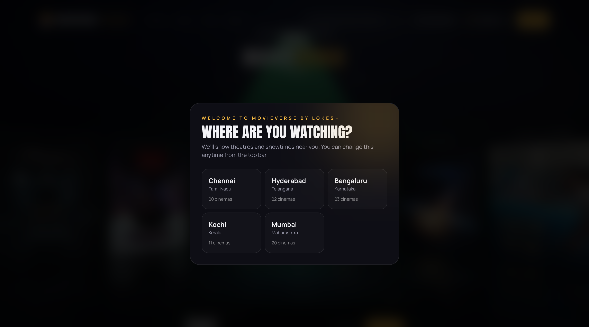
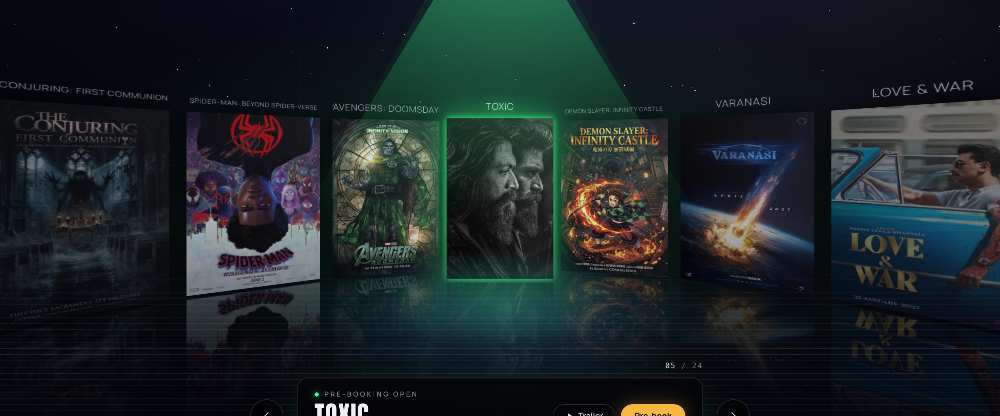
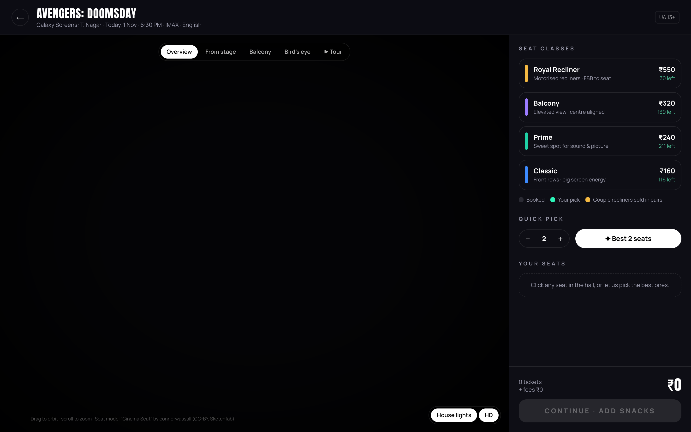
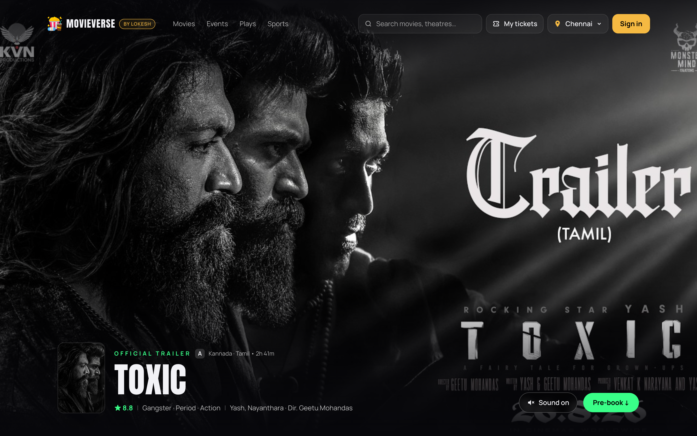
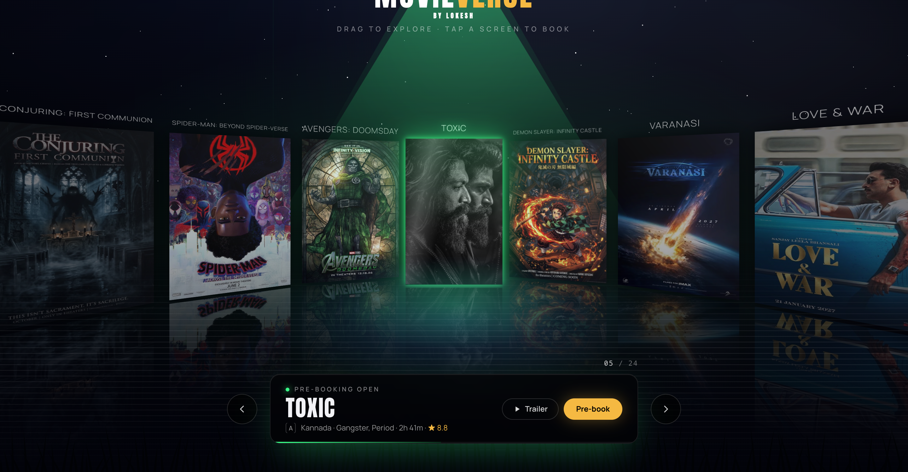

<div align="center">

<p align="center">
  
  &nbsp;&nbsp;&nbsp;&nbsp;
  
</p>

# 🎬 MOVIEVERSE
### Designed, Engineered & Authored by Lokesh

**Next-Generation 3D Cinematic Movie Ticket Booking Experience**

[](https://github.com/lokesh12dev)
[](https://github.com/lokesh12dev)
[](https://github.com/lokesh12dev?tab=repositories)
[](https://github.com/lokesh12dev/movieverse)
[](LICENSE)

---

### 👑 Authorship & Creative Vision
> **Our work, dedication, and time done by Lokesh.**  
> 
> **MOVIEVERSE** is an original creative vision and software architecture engineered and crafted from the ground up exclusively by **Lokesh**. Every custom interface component, 3D auditorium simulation, geometric seat recommendation algorithm, and visual detail is the culmination of personal engineering passion, rigorous craftsmanship, and creative devotion. This project represents authentic creative vision, architectural depth, and dedicated development time authored wholly and exclusively by **Lokesh** ([@lokesh12dev](https://github.com/lokesh12dev)).

---



</div>

---

## 🌟 Executive Overview

**MOVIEVERSE** reimagines cinema ticketing as an ultra-fluid, cinematic 3D journey. Instead of static grids and flat booking interfaces, MOVIEVERSE puts the moviegoer directly into a virtual cinema hall with real-time 3D spatial seat selection, interactive panoramic carousels, responsive showtimes, and instant passbook-ready QR tickets.

Whether browsing upcoming blockbusters on desktop or tapping into a 3D recliner on mobile, MOVIEVERSE delivers silky 60 FPS performance, tactile haptics, and modern luxury design.

---

## ✨ Core Highlights & Features

- **🌀 3D Cylindrical Panorama Carousel:** A curved virtual ring of cinema screens supporting touch swipe, mouse drag, momentum deceleration, and dynamic focal spotlighting with authentic high-resolution movie posters (*Avengers: Doomsday*, *Demon Slayer: Infinity Castle*, *Toxic*, *Varanasi*, *Spider-Man: Beyond Spider-Verse*).
- **🪑 Real-Time 3D Cinema Hall Seat Picker:** Fully rendered 3D auditorium built with Three.js and WebGL. Switch effortlessly between camera presets (*Overview*, *Balcony*, *From Stage*, *Bird's Eye*, *Tour*), or preview the exact sightline to the big screen from any selected chair.
- **🎯 "✦ Best Seats" Smart Selection:** Proprietary heuristic algorithm calculating viewing distance, center sweet-spot acoustic scores, and recliner pairing rules to deliver optimal seat suggestions instantly.
- **🎬 Trailer-First Movie Hub:** Immersive fullscreen video backdrops, dynamic mood grading, detailed cast/crew carousels, and localized show schedules.
- **🍿 Complete End-to-End Booking Lifecycle:** Seamless step-by-step flow: Movie Selection ➜ Theatre & Showtime ➜ 3D Seats ➜ Gourmet Snacks & Concessions ➜ Order Summary ➜ Secure Payment ➜ High-Resolution Dynamic QR Ticket saved to *My Tickets*.
- **⚡ 100% Self-Contained Local Server:** Ultra-fast local server providing instant RSC streaming, zero-latency 3D GLTF asset delivery, and offline-capable seat selection.
- **📱 Mobile-First 60 FPS Performance:** Hand-tuned animations and responsive layouts engineered specifically for iPhone Safari, Android Chrome, and modern high-refresh displays.

---

## 📸 Visual Showcase

| 🎟 3D Hero Carousel & Spotlight | ⏳ Premieres & Pre-Bookings (6 Blockbusters) |
|:---:|:---:|
|  |  |

| 🪑 Interactive 3D Cinema Auditorium | 🎥 Movie Trailer & Showtimes Hub |
|:---:|:---:|
|  |  |

### 🎞 Celluloid Filmstrip Experience


---

## 🛠 Tech Stack & Engineering Systems

- **Core Framework:** Next.js · React · TypeScript
- **3D Graphics & Spatial Computing:** Three.js · React Three Fiber · WebGL Custom Shaders
- **3D Assets & Textures:** Custom glTF 2.0 `seat.glb` binary model + Procedural Acoustic Velour, Wood Slat, and Hessian Weave PBR Textures
- **Motion & Micro-Interactions:** GSAP · Framer Motion · Lenis Smooth Scroll · Tailwind CSS
- **State Architecture:** Zustand reactive state containers
- **Assets & Identity:** Bespoke MOVIEVERSE Cinema Identity & Vector Ticket Artwork by Lokesh

---

## 🧠 Algorithmic Architecture & Engineering

### 1. Heuristic Seat Recommendation Engine
Calculates optimal cinema viewing geometry, penalizing off-angle sightlines, aisle splits, and occupied seats:

```text
function OPTIMIZE_BEST_SEATS(seatCount, occupiedSet, tierPreference):
    optimalCandidate = null
    minPenaltyScore = INFINITY

    for each row in cinemaAuditorium:
        if tierPreference and row.tier != tierPreference:
            continue

        for each contiguousWindow of size seatCount in row:
            if any seat in contiguousWindow is occupied:
                continue
            if contiguousWindow crosses an aisle:
                continue
            if contiguousWindow splits a coupled recliner:
                continue

            // Acoustic and visual sweet-spot scoring
            centerOffset = distanceToCenterAisle(contiguousWindow)
            rowDepthPenalty = abs(row.index - TARGET_SWEET_SPOT_ROW)
            
            penaltyScore = (centerOffset * 1.25) + (rowDepthPenalty * 0.9)
            
            if penaltyScore < minPenaltyScore:
                minPenaltyScore = penaltyScore
                optimalCandidate = contiguousWindow

    return optimalCandidate
```

### 2. 3D Camera Boundary Clamping & Occlusion Prevention
Guarantees the camera never clips through theater walls, balcony balustrades, or the ceiling during free-orbit or preset transitions:

```text
onRenderFrame(deltaTime):
    targetVector = evaluateUserOrbit() or activeCameraPreset.vector
    
    // Boundary collision bounding box
    clampedPosition = clamp3D(
        targetVector,
        BOUNDS.MIN_WALL_MARGIN, BOUNDS.MAX_WALL_MARGIN,
        BOUNDS.FLOOR_CLEARANCE, BOUNDS.CEILING_CLEARANCE
    )

    camera.position.lerp(clampedPosition, 0.08)
    
    // Screen occlusion culling for smooth GPU frame budget
    if isScreenOccludedOrOffscreen(camera):
        pauseTrailerCanvasVideo()
    else:
        resumeTrailerCanvasVideo()
```

### 3. Cylindrical Panorama Math
Maps rectangular poster cards onto a 3D cylindrical manifold with angle-based lighting attenuation:

$$\theta_i = \frac{2\pi \cdot i}{N} + \theta_{\text{offset}}$$

$$x_i = R \cdot \sin(\theta_i), \quad z_i = R \cdot \cos(\theta_i)$$

$$\text{Scale}_i = \text{clamp}\left(1.0 - \frac{|\theta_i|}{\pi} \cdot 0.35, 0.65, 1.15\right)$$

---

## 🚀 Running Locally

To run MOVIEVERSE locally:

```bash
# Clone the official repository
git clone https://github.com/lokesh12dev/movieverse.git
cd movieverse

# Launch the MOVIEVERSE self-contained server
node server.js
```

Open your browser and navigate to:
```
http://localhost:4300
```

---

## 🌍 Live on Vercel

**Production URL:** https://movieverse-ticket-booking.vercel.app

The repository is connected to the Vercel project `movieverse-ticket-booking` and `movieverse` (team *Lokesh-online*):

- **Every push to `main` automatically deploys to production.** Commit and push from here — Vercel rebuilds and ships live within seconds. No manual step, no CLI, no dashboard visit needed.
- The **`public/` directory is Vercel's static output** (served at the site root): `next-assets/` (hydrated React/Turbopack chunks, fonts), `posters/`, `textures/`, `models/` and favicons are delivered from Vercel's **global edge CDN** with immutable year-long caching for hashed assets.
- A `/next-assets:...` rewrite keeps every original `/_next/...` asset URL intact for the React hydration runtime.
- Dynamic pages — `/`, `/movie/:slug`, `/book/:slug?...`, `/bookings`, `/login`, including RSC navigation payloads (`text/x-component`) — are produced by **`api/render/[route].js`**, the serverless renderer carrying the exact synthesis logic of `server.js`, and are edge-cached (`s-maxage` + `stale-while-revalidate`).
- **Speed Insights** and **Web Analytics** instrumentation is embedded in every served page; check the Speed Insights and Analytics tabs in the Vercel dashboard for real visitor vitals.

After upgrading anything under `site/files/`, refresh the served static layout and let the push deploy it:

```bash
bash build.sh          # rsyncs site/files → public/ (served tree)
node tools/build-render.js   # rebuilds api/_pages.js with updated page HTML

git add -A && git commit -m "Upgrade" && git push
```

---

## 👤 Author, Designer & Developer

**Lokesh**
- **GitHub:** [@lokesh12dev](https://github.com/lokesh12dev)
- **All Repositories:** [lokesh12dev Repositories](https://github.com/lokesh12dev?tab=repositories)
- **Location:** Chennai, India

---

## 📜 License & Copyright

**Copyright © 2026 Lokesh. All Rights Reserved.**

This repository and all associated assets, source code, UI/UX designs, algorithms, and documentation are the exclusive intellectual property of **Lokesh** ([@lokesh12dev](https://github.com/lokesh12dev)).

Our work, dedication, and time done by Lokesh. Every feature, interaction, and visual detail in MOVIEVERSE embodies personal creative vision and architectural devotion. Unauthorized reproduction, distribution, or publishing under any other identity or account is strictly prohibited.
