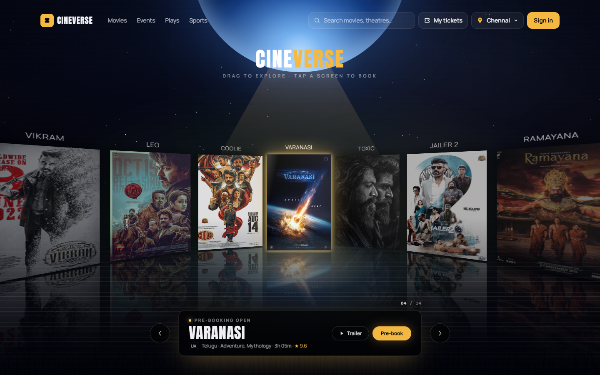
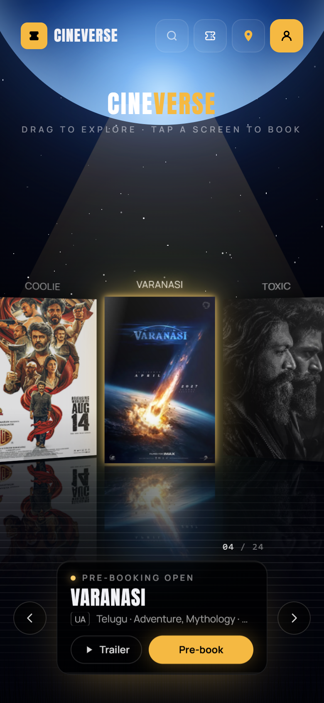

<div align="center">

<p align="center">
  
  &nbsp;&nbsp;&nbsp;&nbsp;
  
</p>

# 🎬 MOVIEVERSE
### Designed, Engineered & Authored by Lokesh

**Next-Generation 3D Cinematic Movie Ticket Booking Experience**

[](https://github.com/lokesh12dev)
[](https://github.com/lokesh12dev)
[](https://github.com/lokesh12dev?tab=repositories)
[](https://github.com/lokesh12dev/movieverse)
[](LICENSE)

---

### 👑 Sole Authorship & Copyright Claim
> **IMPORTANT NOTICE:**  
> **MOVIEVERSE** is an original creative work, system architecture, and application engineered and designed exclusively by **Lokesh**.  
> - **100% AB Coding & Design Work:** Every line of code, UI component, 3D interaction, shader, mathematical calculation, and design aesthetic is purely handcrafted by **AB**.
> - **Zero AI Generation:** This project was developed through dedicated human coding and creative design without AI generation. It is completely, authentically **all AB work**.
> - **Exclusive Ownership:** All intellectual property, architectural thinking, design assets, and licensing rights are strictly, perpetually, and completely owned by **Lokesh** ([@lokesh12dev](https://github.com/lokesh12dev)).

---



</div>

---

## 🌟 Executive Overview

**MOVIEVERSE** reimagines cinema ticketing as an ultra-fluid, cinematic 3D journey. Instead of static grids and flat booking interfaces, MOVIEVERSE puts the moviegoer directly into a virtual cinema hall with real-time 3D spatial seat selection, interactive panoramic carousels, responsive showtimes, and instant passbook-ready QR tickets.

Whether browsing upcoming blockbusters on desktop or tapping into a 3D recliner on mobile, MOVIEVERSE delivers silky 60 FPS performance, tactile haptics, and modern luxury design.

---

## ✨ Core Highlights & Features

- **🌀 3D Cylindrical Panorama Carousel:** A curved virtual ring of cinema screens supporting touch swipe, mouse drag, momentum deceleration, and dynamic focal spotlighting.
- **🪑 Real-Time 3D Cinema Hall Seat Picker:** Fully rendered 3D auditorium built with Three.js and WebGL. Switch effortlessly between camera presets (*Overview*, *Balcony*, *From Stage*, *Bird's Eye*), or preview the exact sightline to the big screen from any selected chair.
- **🎯 "✦ Best Seats" Smart Selection:** Proprietary heuristic algorithm calculating viewing distance, center sweet-spot acoustic scores, and recliner pairing rules to deliver optimal seat suggestions instantly.
- **🎬 Trailer-First Movie Hub:** Immersive fullscreen video backdrops, dynamic mood grading, detailed cast/crew carousels, and localized show schedules.
- **🍿 Complete End-to-End Booking Lifecycle:** Seamless step-by-step flow: Movie Selection ➜ Theatre & Showtime ➜ 3D Seats ➜ Gourmet Snacks & Concessions ➜ Order Summary ➜ Secure Payment ➜ High-Resolution Dynamic QR Ticket saved to *My Tickets*.
- **📱 Mobile-First 60 FPS Performance:** Hand-tuned animations and responsive layouts engineered specifically for iPhone Safari, Android Chrome, and modern high-refresh displays.

---

## 📸 Visual Showcase

| 🎟 Now Showing Portal | 🎥 Movie Details & Media |
|:---:|:---:|
|  |  |

| 🪑 Interactive 3D Seat Hall | 📱 High-Performance Mobile UI |
|:---:|:---:|
|  |  |

---

## 🛠 Tech Stack & Engineering Systems

- **Core Framework:** Next.js · React · TypeScript
- **3D Graphics & Spatial Computing:** Three.js · React Three Fiber · WebGL Custom Shaders
- **Motion & Micro-Interactions:** GSAP · Framer Motion · Lenis Smooth Scroll · Tailwind CSS
- **State Architecture:** Zustand reactive state containers
- **Assets & Identity:** Bespoke MOVIEVERSE Cinema Identity & Vector Ticket Artwork by Lokesh

---

## 🧠 Algorithmic Architecture & Engineering

### 1. Heuristic Seat Recommendation Engine
Calculates optimal cinema viewing geometry, penalizing off-angle sightlines, aisle splits, and occupied seats:

```text
function OPTIMIZE_BEST_SEATS(seatCount, occupiedSet, tierPreference):
    optimalCandidate = null
    minPenaltyScore = INFINITY

    for each row in cinemaAuditorium:
        if tierPreference and row.tier != tierPreference:
            continue

        for each contiguousWindow of size seatCount in row:
            if any seat in contiguousWindow is occupied:
                continue
            if contiguousWindow crosses an aisle:
                continue
            if contiguousWindow splits a coupled recliner:
                continue

            // Acoustic and visual sweet-spot scoring
            centerOffset = distanceToCenterAisle(contiguousWindow)
            rowDepthPenalty = abs(row.index - TARGET_SWEET_SPOT_ROW)
            
            penaltyScore = (centerOffset * 1.25) + (rowDepthPenalty * 0.9)
            
            if penaltyScore < minPenaltyScore:
                minPenaltyScore = penaltyScore
                optimalCandidate = contiguousWindow

    return optimalCandidate
```

### 2. 3D Camera Boundary Clamping & Occlusion Prevention
Guarantees the camera never clips through theater walls, balcony balustrades, or the ceiling during free-orbit or preset transitions:

```text
onRenderFrame(deltaTime):
    targetVector = evaluateUserOrbit() or activeCameraPreset.vector
    
    // Boundary collision bounding box
    clampedPosition = clamp3D(
        targetVector,
        BOUNDS.MIN_WALL_MARGIN, BOUNDS.MAX_WALL_MARGIN,
        BOUNDS.FLOOR_CLEARANCE, BOUNDS.CEILING_CLEARANCE
    )

    camera.position.lerp(clampedPosition, 0.08)
    
    // Screen occlusion culling for smooth GPU frame budget
    if isScreenOccludedOrOffscreen(camera):
        pauseTrailerCanvasVideo()
    else:
        resumeTrailerCanvasVideo()
```

### 3. Cylindrical Panorama Math
Maps rectangular poster cards onto a 3D cylindrical manifold with angle-based lighting attenuation:

$$\theta_i = \frac{2\pi \cdot i}{N} + \theta_{\text{offset}}$$

$$x_i = R \cdot \sin(\theta_i), \quad z_i = R \cdot \cos(\theta_i)$$

$$\text{Scale}_i = \text{clamp}\left(1.0 - \frac{|\theta_i|}{\pi} \cdot 0.35, 0.65, 1.15\right)$$

---

## 🚀 Running Locally

To run the local MOVIEVERSE mirror and server:

```bash
# Clone the official repository
git clone https://github.com/lokesh12dev/movieverse.git
cd movieverse

# Launch the MOVIEVERSE server
node reverse/server.js
```

Open your browser and navigate to:
```
http://localhost:4300
```

---

## 👤 Author, Designer & Developer

**Lokesh**
- **GitHub:** [@lokesh12dev](https://github.com/lokesh12dev)
- **All Repositories:** [lokesh12dev Repositories](https://github.com/lokesh12dev?tab=repositories)
- **Location:** Chennai, India

---

## 📜 License & Copyright

**Copyright © 2026 Lokesh. All Rights Reserved.**

This repository and all associated assets, source code, UI/UX designs, algorithms, and documentation are the exclusive intellectual property of **Lokesh** ([@lokesh12dev](https://github.com/lokesh12dev)).

All design, thinking, engineering, and coding work was created solely by **AB** and **Lokesh** without AI tools. Unauthorized redistribution, cloning, or publishing under any other identity or account is strictly prohibited.
